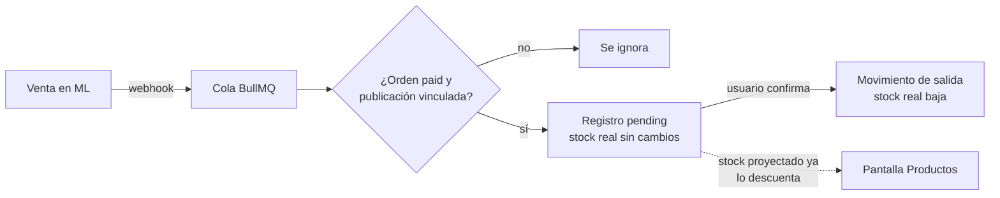
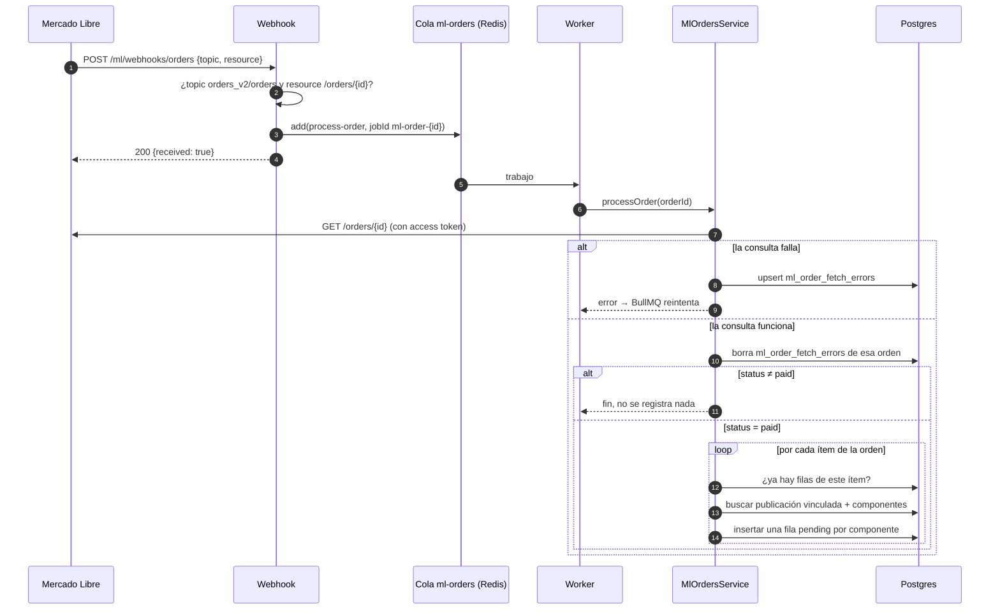
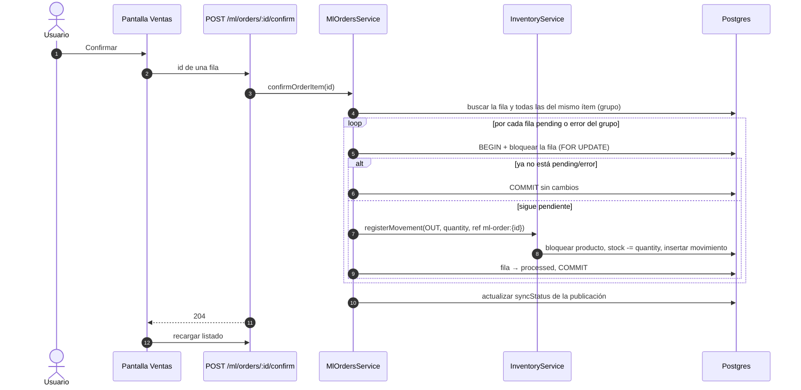
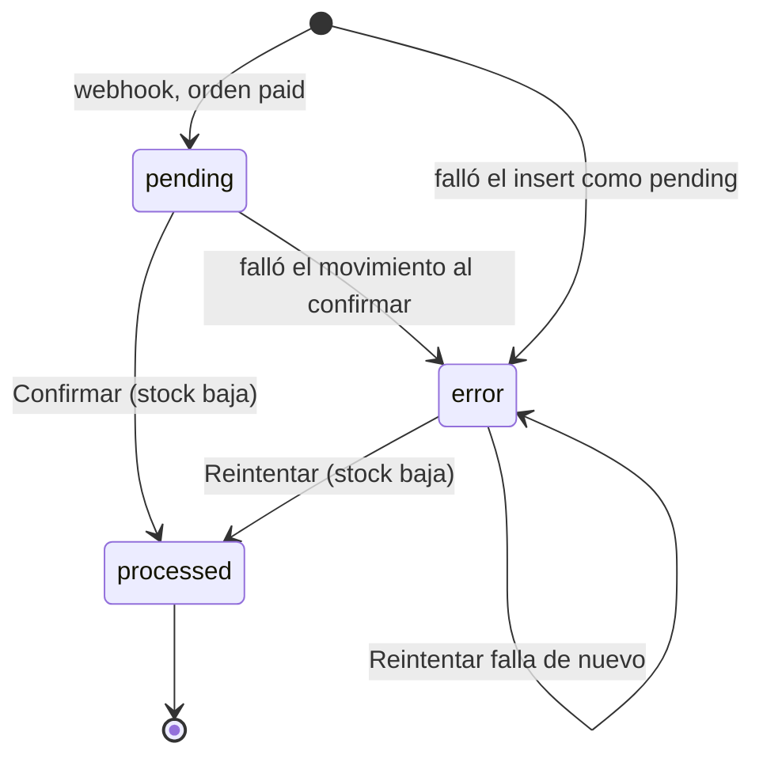

# Descuento de stock por ventas de Mercado Libre

- **Última actualización:** 2026-10-17
- **Código descrito:** rama `main`, commit `b7e4d67`.
- **Cómo se escribió:** leyendo el código. El flujo **no se probó de punta a punta contra Mercado Libre real** (el entorno donde se escribió no tiene acceso a la API de ML). Lo que dice este documento es lo que el código hace según su lectura; los tests unitarios del backend (con mocks) cubren las partes principales de `MlOrdersService`.

Este documento explica qué pasa desde que Mercado Libre avisa que hubo una venta hasta que alguien confirma esa venta en la pantalla **Ventas** y el stock interno se descuenta.

## Resumen

El descuento **no es automático**. El proceso tiene dos etapas separadas:

1. **Detección (automática).** Mercado Libre avisa por webhook, el backend consulta la orden y, si está pagada, deja **un registro `pending` por cada producto interno afectado**. En esta etapa el stock no cambia; solo baja el "stock proyectado".
2. **Confirmación (manual).** Una persona entra a `/ventas` y toca **Confirmar**. Recién ahí se crea el movimiento de salida y baja el stock real.

## Piezas que participan

| Pieza | Archivo | Rol |
|---|---|---|
| Webhook | `backend/src/ml-orders/ml-webhooks.controller.ts` | Endpoint público `POST /ml/webhooks/orders`. Valida la notificación y la encola. |
| DTO de la notificación | `backend/src/ml-orders/dto/ml-webhook-notification.dto.ts` | Solo exige `topic` y `resource` (strings no vacíos). |
| Worker | `backend/src/ml-orders/ml-orders.processor.ts` | Toma los trabajos de la cola `ml-orders` y llama a `processOrder`. |
| Servicio de órdenes | `backend/src/ml-orders/ml-orders.service.ts` | `processOrder`, `processOrderItem` (detección) y `confirmOrderItem` (confirmación). |
| Servicio de inventario | `backend/src/inventory/inventory.service.ts` | `registerMovement`: cambia el stock y crea el movimiento. |
| Autenticación con ML | `backend/src/mercadolibre/ml-auth.service.ts` | Entrega un access token vigente (lo renueva si faltan menos de 5 minutos). |
| Endpoints de ventas | `backend/src/ml-orders/ml-orders.controller.ts` | `GET /ml/orders/processed` (listado) y `POST /ml/orders/:id/confirm` (confirmar). Protegidos con JWT. |
| Pantalla Ventas | `frontend/src/app/pages/sales/` | Lista los registros y permite confirmarlos. |
| Stock proyectado | `backend/src/products/products.service.ts` | Stock real menos las cantidades `pending`. |
| Errores | `backend/src/monitoring/monitoring.service.ts` | Junta los errores que se ven en el dashboard y en Logs. |

## Datos involucrados

### `ml_processed_order_items` — una fila por producto afectado por una venta

| Columna | Qué guarda |
|---|---|
| `mlOrderId`, `mlItemId`, `mlVariationId` | Identifican el ítem vendido (orden + publicación + variación, que puede ser `null`). |
| `productId` | Producto interno que hay que descontar. |
| `quantity` | Unidades a descontar de ese producto = unidades vendidas × `quantityPerUnit` del componente. |
| `orderStatus` | Estado de la orden en ML al momento de registrarla (en la práctica siempre `paid`). |
| `status` | `pending`, `processed` o `error` (ver [estados](#estados-de-un-registro)). |
| `errorMessage` | Motivo del último error, si lo hubo. |
| `processedAt` | Momento en que **se registró** la fila (no la fecha de la venta en ML ni la de la confirmación). |

Una venta de una publicación simple genera **1 fila**. Una venta de un **kit** (publicación compuesta por varios productos, tabla `ml_listing_components`) genera **una fila por componente**. Las filas de un mismo ítem vendido comparten `(mlOrderId, mlItemId, mlVariationId)` y se tratan como un grupo.

Protecciones contra duplicados en la base: dos índices únicos parciales sobre `(mlOrderId, mlItemId, mlVariationId, productId)`, uno para filas con variación y otro para filas sin variación (migración `AddMlProcessedOrderItemsUniqueConstraint`). **Solo existen si se corrieron las migraciones**, o sea en producción; en desarrollo se usa `synchronize` y no se crean.

### Otras tablas que el flujo toca

- `ml_order_fetch_errors`: una fila por orden que no se pudo consultar en ML (único por `mlOrderId`). Se borra cuando la consulta vuelve a funcionar.
- `inventory_movements`: el movimiento de salida que crea la confirmación.
- `products.stock`: el stock real.
- `ml_listings.syncStatus` / `lastSyncError` / `lastSyncedAt`: estado de la publicación vinculada, que se actualiza al confirmar.

## Etapa 1 — Detección (automática)

### Paso 1. Llega la notificación

`MlWebhooksController.receive`:

- Es **público** (sin JWT) porque lo llama Mercado Libre.
- Valida el cuerpo con el DTO: si falta `topic` o `resource`, responde 400.
- Si el `topic` no es `orders_v2` ni `orders`, responde `200 {received: true}` y no hace nada.
- Si el `resource` no tiene la forma `/orders/{número}`, responde 200 y no hace nada.
- **No usa nada más del cuerpo**: los datos de la orden siempre se vuelven a pedir a la API de ML con el token propio. Tampoco verifica que la notificación venga realmente de ML ni de qué vendedor es.
- Está sujeto al rate limit global (100 solicitudes por minuto por IP).

### Paso 2. Se encola

Se agrega a la cola `ml-orders` un trabajo `process-order` con:

| Opción | Valor | Efecto |
|---|---|---|
| `jobId` | `ml-order-{id}` | Si ya existe un trabajo con ese id en la cola, el nuevo **se descarta**. |
| `attempts` | 3 | Hasta 3 intentos en total. |
| `backoff` | exponencial, 5 s | Espera de 5 s y luego 10 s entre intentos. |
| `removeOnComplete` | `true` | Al terminar bien, el trabajo se borra (una notificación posterior de la misma orden vuelve a encolarse). |
| `removeOnFail` | 100 | Se guardan los últimos 100 trabajos fallidos (**mientras estén guardados, bloquean nuevas notificaciones de esa orden**; ver [limitaciones](#limitaciones-conocidas)). |

Después de encolar, responde `200` a ML de inmediato, sin esperar el procesamiento.

### Paso 3. El worker consulta la orden

`MlOrdersProcessor.process` llama a `MlOrdersService.processOrder(orderId)`. El worker procesa **de a un trabajo por vez** (no configura concurrencia, así que usa la de BullMQ por defecto).

`processOrder`:

1. Pide un access token vigente a `MlAuthService.getValidAccessToken()`. Si no hay cuenta de ML conectada o la renovación falla, eso cuenta como fallo de la consulta.
2. Hace `GET https://api.mercadolibre.com/orders/{id}` con timeout de 10 s.
3. **Si falla:** guarda (o actualiza) una fila en `ml_order_fetch_errors` con el detalle del error (status HTTP y cuerpo que devolvió ML) y relanza el error para que BullMQ reintente. Este error aparece en el dashboard y en Logs como "order_fetch".
4. **Si funciona:** borra la fila de `ml_order_fetch_errors` de esa orden, si había.
5. Si el estado de la orden **no es `paid`**, deja un log y termina. No se registra nada. Como el trabajo se borra al completarse, cuando ML avise que la orden pasó a `paid` se procesa de nuevo.
6. Si es `paid`, procesa cada ítem de la orden (`processOrderItem`), uno por uno.

### Paso 4. Se registran las filas `pending`

`processOrderItem`, para cada ítem de la orden:

1. **Chequeo de idempotencia:** busca si ya hay filas con el mismo `(mlOrderId, mlItemId, mlVariationId)`, sin importar el producto. Si hay alguna, **ignora el ítem por completo**: no vuelve a mirar la composición actual de la publicación ni crea nada. Esto evita duplicados si ML reenvía la notificación o si después se cambian los componentes del vínculo.
2. **Busca la publicación vinculada** en `ml_listings` por `mlItemId` + `mlVariationId`, con sus componentes. Si no existe o no tiene componentes, deja un warning en el log y **sigue sin registrar nada**: la venta no aparece en Ventas ni en errores.
3. **Por cada componente** inserta una fila con `status = pending`, `quantity = unidades vendidas × quantityPerUnit` y `orderStatus = paid`.
   - Si el insert choca con el índice único (código Postgres `23505`, otra ejecución ya la insertó), se salta ese componente.
   - Si falla por otro motivo, intenta guardar la fila con `status = error` y el mensaje.

En este punto **el stock real no cambió**. Lo que sí cambia es el **stock proyectado** que muestra la pantalla Productos: `stock - suma de quantity de las filas pending de ese producto`. Lo mismo usa la comparación de stock con ML (`stock-check`, solo en `backend/main` por ahora).

## Etapa 2 — Confirmación (manual)

### Lo que ve el usuario en `/ventas`

- Una tabla con **una fila por producto** (un kit muestra varias filas para la misma orden), con fecha de registro, producto, orden de ML, cantidad y estado (Pendiente / Procesada / Error con su mensaje).
- Filtros por rango de fechas, estado y texto (busca en nombre o SKU del producto, id de orden e id de publicación). Cada cambio de filtro vuelve a pedir el listado al backend.
- En cada fila que no está `processed`, un botón **Confirmar** (o **Reintentar** si está en `error`).
- Arriba, el botón **Confirmar pendientes visibles (N)**, donde N es la cantidad de ítems vendidos pendientes (cuenta grupos, no filas).

El dashboard también muestra las ventas registradas hoy, con su estado.

### Qué pasa al tocar Confirmar

Detalle de `confirmOrderItem(id)`:

1. Busca la fila por `id`. Si no existe, responde 404.
2. Busca **todas las filas del mismo grupo** `(mlOrderId, mlItemId, mlVariationId)` y se queda con las que están `pending` o `error`. Si no queda ninguna, termina sin hacer nada. O sea: **confirmar cualquier fila de un kit confirma el kit completo**.
3. Para cada fila, en **su propia transacción**:
   1. La vuelve a leer con bloqueo `pessimistic_write`. Si otra ejecución ya la resolvió, no hace nada.
   2. Llama a `InventoryService.registerMovement` con tipo `OUT`, la cantidad de la fila, motivo `Venta Mercado Libre` y referencia `ml-order:{mlOrderId}`, dentro de la misma transacción.
   3. `registerMovement` bloquea el producto, le resta la cantidad al stock **sin validar que alcance (el stock puede quedar negativo)**, y guarda el movimiento con `balanceAfter` (stock resultante) y `quantity` como delta con signo (negativo en una salida).
   4. Marca la fila como `processed` y borra el `errorMessage`.
4. Si una fila falla, esa transacción se revierte, la fila queda en `error` con el mensaje, y **el resto del grupo se sigue procesando**. Un kit puede quedar confirmado a medias (unos componentes `processed` y otros `error`); el botón Reintentar procesa solo los que faltan.
5. Al final actualiza la publicación vinculada: `syncStatus = synced` si no hubo errores, o `error` con el mensaje "No se pudo descontar el stock de algún componente…" si hubo alguno. Ese estado se ve en la pantalla de publicaciones vinculadas y como error en el dashboard.
6. El endpoint responde `204` y la pantalla recarga el listado. Si falló la llamada, muestra el mensaje arriba de la tabla.

**Confirmar pendientes visibles** hace lo mismo para cada grupo pendiente que esté en pantalla con los filtros actuales, **de a uno y en orden** (una llamada por grupo). Si alguna falla, sigue con las demás y muestra el último error.

Como ya no se valida el stock suficiente, en la práctica una confirmación solo debería fallar por problemas de base de datos o si el producto ya no existe.

## Estados de un registro

No existe ningún camino que saque una fila de `pending` sin descontar stock (por ejemplo, si la orden se cancela). Tampoco hay forma de deshacer una fila `processed` desde la aplicación: habría que hacer un ajuste manual de stock.

## Dónde se ven los problemas

| Situación | Dónde aparece |
|---|---|
| No se pudo consultar una orden en ML | Dashboard y Logs, tipo "order_fetch", con el detalle de ML. Desaparece cuando una consulta posterior funciona. |
| Una fila quedó en `error` | Ventas (fila en rojo con el mensaje), dashboard y Logs, tipo "order_processing". |
| Una publicación quedó en `error` al confirmar | Publicaciones vinculadas, dashboard y Logs, tipo "ml_listing". |
| La conexión con ML está en error | Dashboard y Logs, tipo "ml_connection". |
| Venta de una publicación no vinculada | **En ningún lado de la interfaz**, solo en el log del servidor. |
| Orden cuyo trabajo falló 3 veces | Como "order_fetch" en el dashboard, pero no hay botón para reintentar. |

El dashboard filtra los errores para mostrar solo los de hoy.

## Limitaciones conocidas

Detalladas en el [análisis del 2026-10-14](../revisiones/2026-10-14-analisis-proyecto-y-ramas.md) y con propuestas en [mejoras propuestas](../ideas/mejoras-propuestas.md):

- **Notificaciones que se pierden** (análisis 4.1): un trabajo fallido guardado, o uno que se está procesando, hace que se descarten nuevas notificaciones de la misma orden. Tampoco hay una reconciliación periódica que recupere ventas cuyo webhook nunca llegó.
- **Cancelaciones y devoluciones** (análisis 4.2): una orden cancelada después de registrarse queda `pending` para siempre (y sigue restando del stock proyectado); si ya se confirmó, el stock no se devuelve.
- **Ventas de publicaciones no vinculadas:** se ignoran sin dejar rastro en la interfaz. Si se vincula la publicación después, esa venta solo se registra si ML vuelve a notificar la orden.
- **Renovación del token sin protección contra llamadas simultáneas** (análisis 4.3): puede hacer fallar la consulta de una orden.
- **Stock negativo permitido** (análisis 4.4).
- **Fechas en UTC:** el filtro de fechas de Ventas y "ventas de hoy" del dashboard cortan el día en UTC, no en la hora local (análisis 4.6).
- **Sin verificación de origen del webhook:** cualquiera puede llamar al endpoint; el daño está acotado porque los datos siempre se piden a ML con el token propio, pero puede generar consultas innecesarias.
- **Comentario desactualizado:** en `inventory-movement.entity.ts` dice que `quantity` es "siempre positivo en IN/OUT", pero el servicio guarda el delta con signo (negativo en las salidas).
