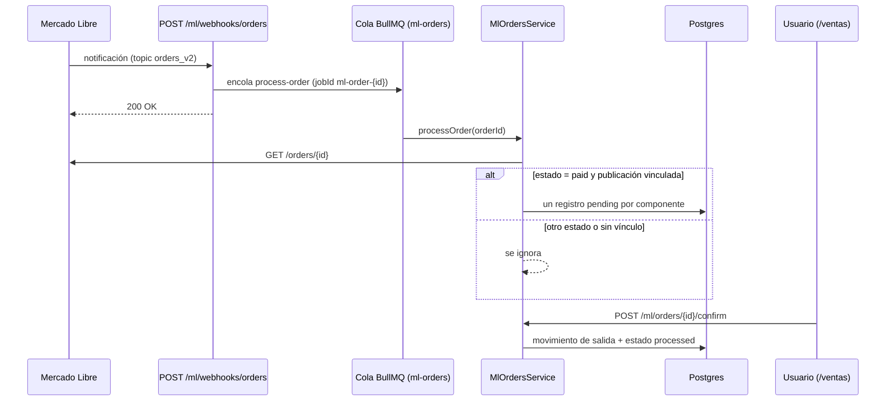

# Análisis del proyecto y de las ramas `frontend/main` y `backend/main`

- **Fecha del análisis:** 2026-10-14
- **Código analizado:** commit `aa4c357` (punta de `backend/main` y de `frontend/main`, que en esa fecha eran idénticas). `main` estaba en `665b670`, un commit por detrás.
- **Alcance:** lectura del código del backend y del frontend, build, tests y lint. No se probó contra servicios reales (ver la sección 3, "Qué se verificó y qué no").

## 1. Estado de las ramas

| Rama | Commit | Estado |
|---|---|---|
| `main` | `665b670` | Rama principal. |
| `backend/main` | `aa4c357` | Un commit por delante de `main` ("stock check"). |
| `frontend/main` | `aa4c357` | Exactamente el mismo commit que `backend/main`. |
| `claude/mvp-inventory-mercado-libre-a2paft` | `6a26de3` | 11 commits por detrás; desactualizada. |

- **`frontend/main` y `backend/main` no están separadas por capa.** Las dos contienen el monorepo completo (`/backend` + `/frontend`) y apuntan al mismo commit. Si la intención era tener una rama por capa, en la práctica no funciona así.
- Lo único que no está en `main` es el commit `aa4c357`: el endpoint `GET /ml/listings/stock-check` y su integración en la pantalla de publicaciones vinculadas.
- Cambios recientes (los 11 commits posteriores a `6a26de3`):
  - Pantalla de **Ventas** (`/ventas`).
  - Estado `pending` en las ventas detectadas, que ahora se confirman a mano.
  - "Stock proyectado" en Productos.
  - Errores del dashboard filtrados al día de hoy, con enlace al detalle.
  - Vinculación masiva de publicaciones, con chequeo de SKU duplicado y validación de campos.
  - Despliegue apuntando a Railway.

**Recomendación:** integrar `aa4c357` a `main` y, o bien borrar `frontend/main` y `backend/main`, o bien definir explícitamente para qué sirve cada una. Para el trabajo diario conviene usar ramas de feature que salgan de `main`.

## 2. Arquitectura actual

### Backend — NestJS 11 + TypeORM + PostgreSQL + BullMQ/Redis

| Módulo | Responsabilidad |
|---|---|
| `auth` | Login de un único admin (credenciales por variables de entorno, hash bcrypt) y JWT con expiración de 1 día. |
| `products` | Catálogo interno. Calcula el "stock proyectado" (stock real menos ventas ML pendientes de confirmar). |
| `inventory` | Movimientos de stock (`in`, `out`, `adjustment`) con bloqueo pesimista sobre el producto. |
| `mercadolibre` | Conexión OAuth con PKCE; tokens cifrados con AES-256-GCM y renovados automáticamente cuando faltan menos de 5 minutos para vencer. |
| `ml-listings` | Vínculo publicación (y variación) de ML ↔ productos internos, incluidos kits de varios productos. Búsqueda de publicaciones propias y comparación de stock contra ML (`stock-check`). |
| `ml-orders` | Webhook público de ML → cola BullMQ → consulta de la orden → registro de la venta como `pending` → confirmación manual que descuenta stock. |
| `monitoring` | Errores agregados para el dashboard y la página de logs. |
| `backups` | `pg_dump` comprimido nocturno (03:00) más respaldo manual, con retención configurable. |
| `projections` | Simulación financiera (punto de equilibrio, ganancias). No modifica stock ni ML. |

Seguridad y operación: helmet, rate limit global de 100 solicitudes por minuto (5 por minuto en el login), CORS restringido a `FRONTEND_URL`, validación de variables de entorno obligatorias en producción y 8 migraciones de TypeORM (en producción se ejecutan al arrancar).

### Flujo de ventas (cambió respecto del plan original)

En el plan original, el webhook descontaba stock automáticamente. Ahora:

### Frontend — Angular 21 + Ionic 8 (PWA)

- Componentes standalone con carga diferida por ruta y signals.
- `authGuard` y un interceptor que agrega el JWT y redirige a `/login` ante un 401.
- Páginas: dashboard, productos, ventas, integración ML (vinculadas, publicaciones sin vincular, productos sin vincular), logs, respaldos y proyecciones.
- En producción la URL del backend está fija en `frontend/src/environments/environment.prod.ts` (Railway).

## 3. Qué se verificó y qué no

| Verificación | Resultado |
|---|---|
| Build del backend (`nest build`) | ✅ Compila. |
| Tests del backend (Jest) | ✅ 98 de 98 pasan. |
| Typecheck completo del backend (`tsc --noEmit`) | ❌ 1 error en un test desactualizado (ver punto 8 de la sección 4). |
| Lint del backend (ESLint + Prettier) | ❌ 319 errores, casi todos de formato y corregibles con `--fix`. |
| Build del frontend (`ng build`) | ✅ Compila, con un aviso: el bundle inicial pesa 1,10 MB y supera el límite configurado de 1 MB. |
| Tests del frontend (Vitest) | ⚠️ Pasa el único test que existe; la UI prácticamente no tiene tests. |

**No se verificó:**

- Nada contra Postgres o Redis reales: todos los tests del backend usan mocks.
- Nada contra la API de Mercado Libre: el entorno donde se hizo el análisis no tenía acceso de red a ML.
- El despliegue en Railway.
- Las migraciones nuevas: no se corrieron contra una base real.

Los problemas de la sección siguiente salen de leer el código; ninguno se reprodujo en un entorno real. Salvo los dos marcados en 4.8, todos están presentes tanto en `main` como en `backend/main`.

## 4. Problemas encontrados

Ordenados de más a menos grave.

### 4.1 Pueden perderse notificaciones de Mercado Libre

`backend/src/ml-orders/ml-webhooks.controller.ts` encola cada orden con un identificador fijo (`ml-order-{id}`) y conserva los trabajos fallidos (`removeOnFail: 100`). BullMQ ignora un trabajo nuevo si ya existe uno con el mismo identificador.

Ejemplo: la consulta de una orden falla 3 veces (token vencido, caída de ML). Desde ese momento, cualquier notificación nueva de esa orden, incluida la que avisa que quedó pagada, se descarta sin aviso mientras el trabajo fallido siga guardado. Lo mismo pasa si llega una notificación mientras la anterior de esa orden todavía se está procesando.

### 4.2 Las cancelaciones y devoluciones no se manejan

`MlOrdersService.processOrderItem` ignora cualquier notificación de una orden que ya tiene registros. Si una orden se paga y después se cancela antes de confirmarla, la venta queda en `pending` para siempre: sigue restando del stock proyectado y alguien podría confirmarla por error. Si la cancelación llega después de confirmar, el stock tampoco se devuelve.

### 4.3 Falla posible al renovar el token de Mercado Libre

`MlAuthService.ensureValidAccessToken` no está protegido contra llamadas simultáneas, y Mercado Libre invalida el refresh token después de usarlo una vez. Si el procesamiento de órdenes y la pantalla (estado de conexión o `stock-check`) renuevan el token al mismo tiempo, una de las dos llamadas falla y la conexión puede quedar marcada como `ERROR`.

### 4.4 Ahora se permite stock negativo

Fue un cambio intencional: se quitó la validación en `InventoryService.registerMovement`, el test pasó a llamarse "permite una salida que deja stock negativo" y la creación de productos acepta stock inicial negativo. Consecuencias:

- El caso de "stock insuficiente" al confirmar una venta ya no ocurre, así que el estado `error` de una venta casi nunca va a aparecer.
- El `README.md` y algunos comentarios todavía describen el comportamiento anterior.

### 4.5 Borrar un producto borra su historial

Los movimientos de inventario, las ventas registradas (`ml_processed_order_items`) y los componentes de kits tienen `onDelete: CASCADE` hacia el producto. Eliminar un producto deja sin rastro su historial, y eso también afecta las sugerencias del módulo de proyecciones. Sería más seguro un borrado lógico (marcarlo como inactivo).

### 4.6 Filtros de fecha en hora UTC

`MlOrdersService.findProcessed` filtra con `T00:00:00Z` / `T23:59:59.999Z`, o sea en hora UTC. Operando desde Chile o Argentina, el corte del día queda corrido 3 o 4 horas.

### 4.7 Desarrollo y producción tienen esquemas distintos

En desarrollo se usa `synchronize: true` y no se ejecutan migraciones, así que los índices únicos parciales que protegen contra ventas duplicadas (migración `AddMlProcessedOrderItemsUniqueConstraint`) solo existen en producción. Un problema de duplicados no se vería en desarrollo.

### 4.8 Deuda menor

- *(Solo en `backend/main`, llega a `main` al integrar `aa4c357`)* `backend/src/ml-listings/ml-listings.service.spec.ts` no pasa el nuevo parámetro del constructor. Jest no lo detecta porque no verifica tipos (`isolatedModules`), pero `tsc --noEmit` sí.
- *(Solo en `backend/main`)* El nuevo `MlListingsService.checkStock` no tiene tests.
- `MlListingsService.updateComponents` borra y vuelve a guardar los componentes sin una transacción.
- El estado del login OAuth de ML (PKCE) se guarda en memoria: se pierde si el servidor se reinicia y no funciona con más de una instancia.
- La URL del backend de Railway está fija en `environment.prod.ts`.
- El JWT se guarda en `localStorage` y el frontend no revisa si ya expiró antes de usarlo (se entera recién con el 401).

## 5. Recomendaciones

1. Corregir 4.1, 4.2 y 4.3. Son cambios acotados:
   - Que un trabajo fallido no bloquee notificaciones nuevas de la misma orden.
   - Que una notificación de orden cancelada actualice las ventas pendientes.
   - Que la renovación del token no pueda ejecutarse dos veces al mismo tiempo.
2. Ejecutar `prettier --write`, corregir el test desactualizado y agregar `tsc --noEmit` a la verificación habitual.
3. Ordenar las ramas como se describe en la sección 1.
